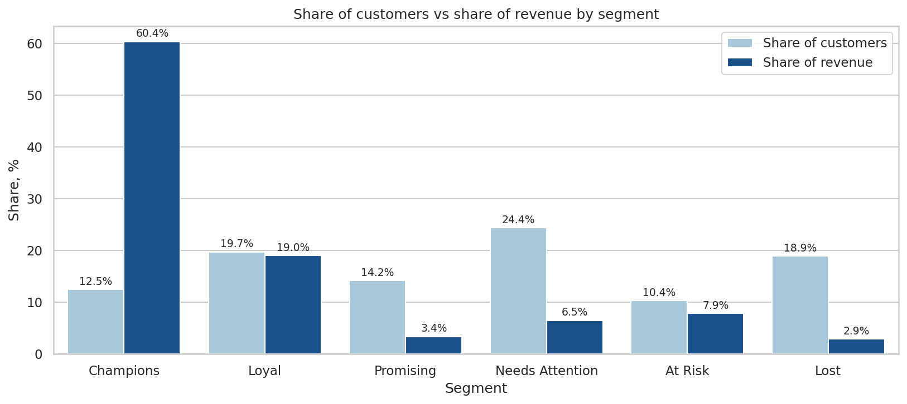
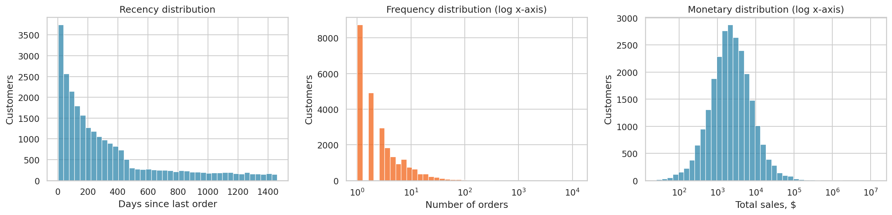
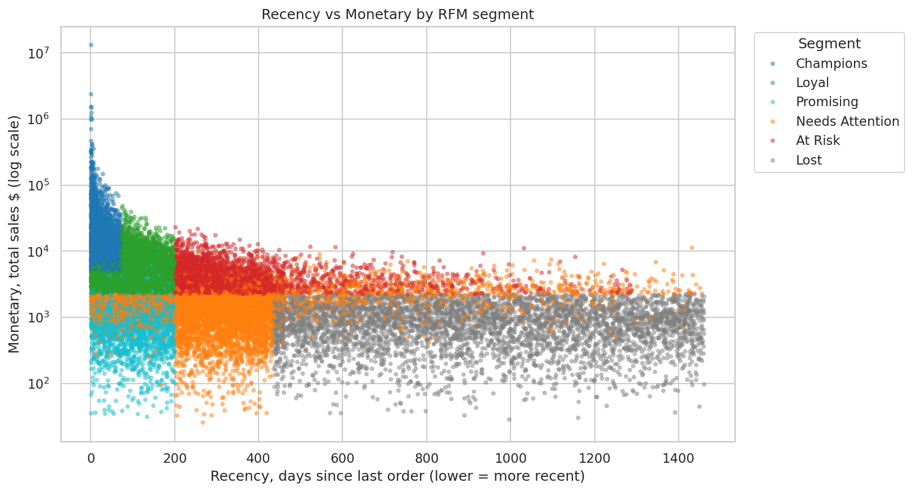
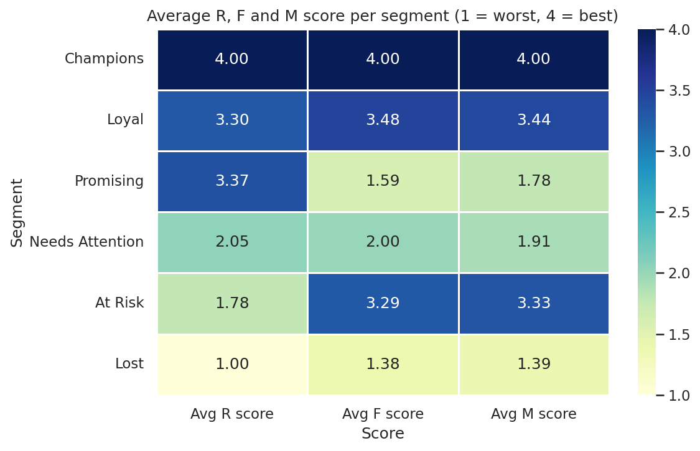
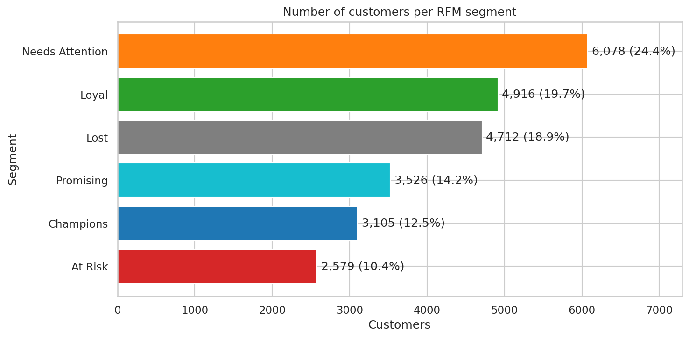
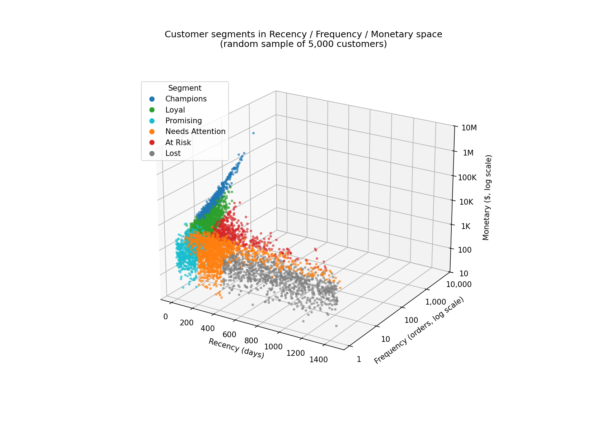

# RFM Customer Segmentation — Who Drives Revenue and Who Is Slipping Away

A complete, rule-based **RFM (Recency, Frequency, Monetary) segmentation** built in Python from 500,000 raw order lines. Every customer is scored 1–4 on each dimension, assigned to one of six business segments, and each segment gets a concrete marketing action and KPI.

**Stack:** Python · pandas · NumPy · Matplotlib · Seaborn · Plotly
**Author:** Edalet Sadigov

| Guide | What is inside |
|---|---|
| [Dataset guide](docs/README_dataset.md) | 500,000 rows, 25 columns, every column explained, data-quality notes |
| [Notebook guide](docs/README_notebook.md) | Libraries and why each was used, notebook structure, how to run |
| [Chart guide](charts/README.md) | All six charts with a link and a short analysis each |

---

## Headline results

Reference date **2026-01-01** (last order date + 1 day). **24,916 customers** scored after excluding cancelled orders.

| Segment | Customers | Share of customers | Share of revenue | Avg recency (days) | Avg orders | Avg spend |
|---|---|---|---|---|---|---|
| **Champions** | 3,105 | 12.5% | **60.4%** | 28 | 27.9 | $29,595 |
| **Loyal** | 4,916 | 19.7% | 19.0% | 100 | 5.7 | $5,880 |
| **Promising** | 3,526 | 14.2% | 3.4% | 99 | 1.4 | $1,453 |
| **Needs Attention** | 6,078 | 24.4% | 6.5% | 355 | 1.8 | $1,625 |
| **At Risk** | 2,579 | 10.4% | 7.9% | 376 | 4.2 | $4,635 |
| **Lost** | 4,712 | 18.9% | 2.9% | 909 | 1.1 | $921 |

Overall averages for comparison: 335 days since last order, 5.9 orders, $6,104 spend per customer (median: 201 days, 2 orders, $2,230).

---

## Key insights

### 1. A small group produces most of the revenue

Champions are **12.5% of customers but 60.4% of revenue** — 4.8 times their customer share, with an average spend 4.8× the overall average ($29,595 vs $6,104). Champions and Loyal together are **32.2% of customers and 79.4% of revenue**.



*Reading the chart: the dark bar (revenue) towers over the light bar (customers) only for Champions; Promising, Needs Attention and Lost are the reverse.*

### 2. Revenue is concentrated even inside the top segment

The top 20% of customers by spend generate **73.1%** of revenue, the top 1% (249 customers) **32.4%**, and **one account alone 8.7%** ($13.2M, 11,804 orders). Rank-based scoring keeps this account from distorting the scores, but it does inflate the Champions' average spend ($29,595 average vs $12,426 median).



*Reading the chart: Frequency and Monetary have a very long right tail (log axes) — the reason quartile ranks are used instead of fixed thresholds.*

### 3. A valuable group has gone quiet and is still recoverable

**At Risk** customers (2,579, 10.4%) averaged 4.2 orders and $4,635 in the past but last ordered about 376 days ago. They hold $11.95M of historical revenue (7.9%). They look like Champions and Loyal customers, except for Recency — the clearest win-back target in the base.



*Reading the chart: the red At Risk band sits at the same spend level as Loyal and Champions but far to the right (long time since last order).*

### 4. Over a third of customers have placed a single order — but they are not one group

**35.0%** of customers have exactly one order (median Frequency is 2). Some are recent first-time buyers (**Promising**, R 3.37, F 1.59) and need nurturing; others are long inactive (**Lost**, R 1.00, F 1.38) and are not worth heavy spending. The same low Frequency needs opposite actions depending on Recency.



*Reading the chart: compare the Promising and At Risk rows — one has high R and low F/M, the other low R and high F/M.*

### 5. Segment sizes show where the work is

Needs Attention is the largest segment (24.4%) and Lost is 18.9%, so more than four in ten customers (43.3%) are either drifting or inactive and contribute only 9.3% of revenue combined.



*Reading the chart: the biggest bars are not the most valuable ones — see insight 1.*

### 6. R, F and M are not three independent signals

Frequency and Monetary correlate at **ρ = 0.87** (Spearman), partly by construction since Monetary adds up the order lines behind Frequency. Recency is the more independent dimension (R–F −0.60, R–M −0.53). Customers form one band from “recent, frequent, high spend” to “old, rare, low spend”.



*Reading the chart: customers lie along a diagonal rather than filling the cube; the interactive version is in the notebook.* These are associations in one dataset and do not show that raising order frequency would raise spend.

### 7. The extremes are stable; the middle depends on method choices

Changing how Frequency ties are broken moves **6.4% of customers** to another segment. Champions (3,105 → 3,151) and Promising (3,526 → 3,531) barely change, but At Risk grows by 18% (2,579 → 3,056) and Needs Attention shrinks by 16% (6,078 → 5,079). The ranking of segments by value holds; the exact sizes of the middle segments are approximate.

---

## Recommendations

| Priority | Segment | Action | KPI to track |
|---|---|---|---|
| 1 | **At Risk** (2,579) | Personal outreach from the sales team for the largest accounts, a “we miss you” offer and a feedback call on why they stopped ordering. | Share ordering again within 90 days; recovered revenue |
| 2 | **Promising** (3,526) | Onboarding email series, reorder reminders and a small time-limited incentive on the second or third order. | Second-order rate; days between order 1 and 2 |
| 3 | **Loyal** (4,916) | Move them toward Champions with volume-tier incentives aimed at 5+ orders or $4,922+ total, bundles and cross-sell from past orders. | Share promoted to Champions; average order value |
| Always | **Champions** (3,105) | Recognise, do not discount: VIP programme, named account manager for the largest accounts, early access to new products, referral requests. Protect the 60.4% of revenue. | Share still in the top Recency group next quarter |
| Test | **Needs Attention** (6,078) | A/B test a reminder email vs a limited-time offer and send a short survey on what blocks the next order. | Reactivation rate vs control |
| Low cost | **Lost** (4,712) | One automated email sequence only; stop contacting non-responders. No account-manager time. | Response rate; cost per reactivated customer |

**How to confirm these work:** run each action on a random half of the segment and keep the other half as control. RFM describes past behaviour; only an experiment shows that an action changes it.

---

## Method in short

1. **Clean:** exclude `Cancelled` orders (3,080 orders, 2.1%); 181 customers with only cancelled orders drop out. Checks: one order = one customer, one date, one status; `SALES = quantity × price`.
2. **Compute per customer:** Recency = days from last order to 2026-01-01; Frequency = number of **unique** orders; Monetary = sum of `SALES`.
3. **Score 1–4 with `pd.qcut`** on `rank(method='first')`; Recency labels are inverted so 4 = most recent. Top score means: ≤ 72 days, ≥ 5 orders, ≥ $4,922.
4. **Segment** with ordered rules (first match wins): Champions R=4,F=4,M=4 → Loyal R≥3,F≥3,M≥3 → Promising R≥3,F≤2 → At Risk R≤2,F≥3,M≥3 → Lost R=1,F≤2,M≤2 → everyone else Needs Attention.
5. **Check robustness:** Spearman correlation, revenue concentration, tie-breaking sensitivity.

Full detail: [notebook guide](docs/README_notebook.md).

---

## Limitations

- **A snapshot, not a forecast.** At Risk and Lost are risk labels based on past behaviour, not confirmed churn; the normal time between orders for each customer was not modelled.
- **Monetary is revenue, not profit.** Margin is not in the data, so “most valuable” means highest revenue.
- **Frequency ties.** About 60% of customers have an F score partly decided by tie-breaking (many share 1–2 orders), so At Risk and Needs Attention sizes are approximate.
- **One very large account** (8.7% of revenue) inflates segment averages; medians are reported next to means.
- **Disputed orders are kept** (1,509 orders) and may turn into refunds.
- **Segment rules are judgement-based**, not optimised; other thresholds would shift the sizes.
- **Data origin.** The extreme concentration and the `Cust_<id>` naming suggest the data may be synthetically generated. Treat the numbers as a demonstration of the method unless the source is confirmed. See the [dataset guide](docs/README_dataset.md).

**Data that would close the gaps:** product margin, customer acquisition date (to separate new from lapsed customers), and a holdout experiment for each action.

---

## Repository structure

```
rfm-customer-segmentation/
├── README.md                   <- this file
├── RFM_python_analysis.ipynb   <- full analysis, executed, with outputs
├── common.py                   <- shared imports
├── rfm_segments_report.csv     <- customer-level RFM table for the marketing team (24,916 rows)
├── charts/                     <- 6 PNG charts + chart guide
│   └── README.md
├── docs/
│   ├── README_dataset.md
│   └── README_notebook.md
└── .gitignore                  <- rfm_sales.csv is not committed (92 MB)
```

## Run it

```bash
pip install pandas numpy matplotlib seaborn plotly scipy jupyter
# place rfm_sales.csv next to the notebook (not included, 92 MB)
jupyter notebook RFM_python_analysis.ipynb
```
